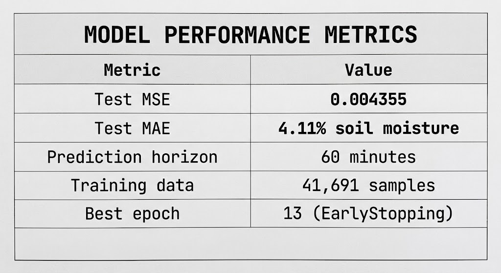
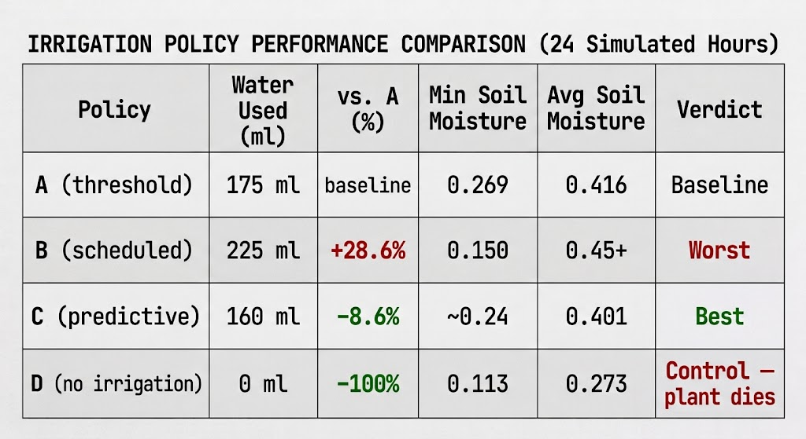
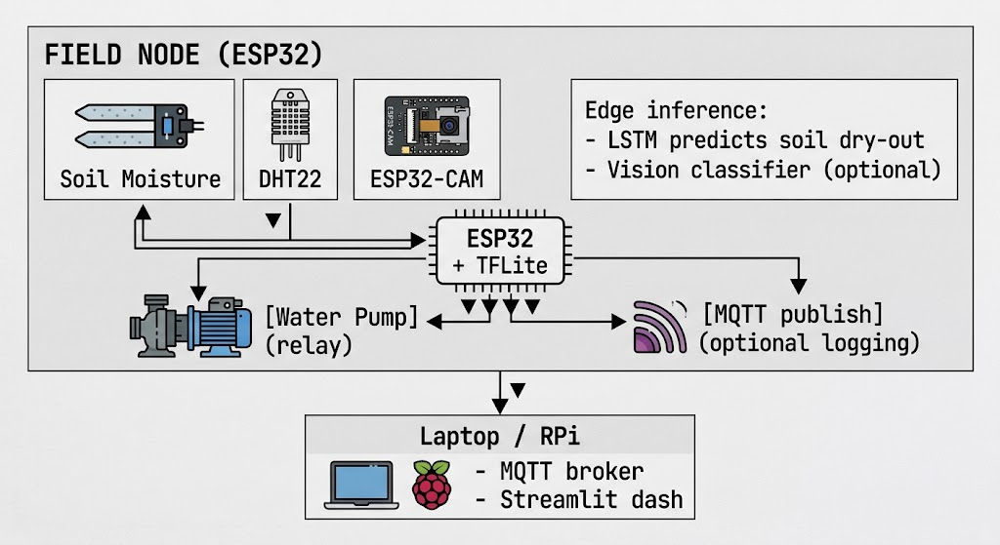
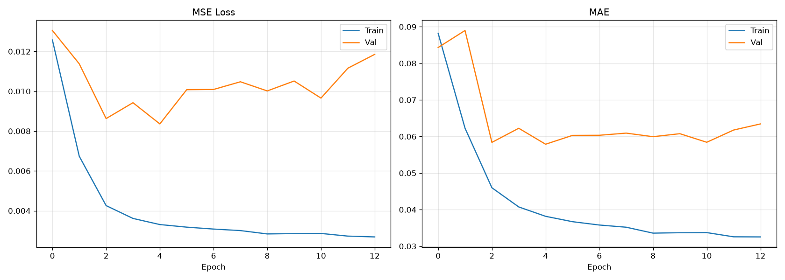
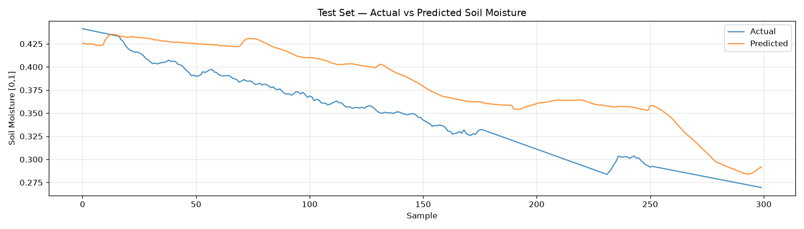
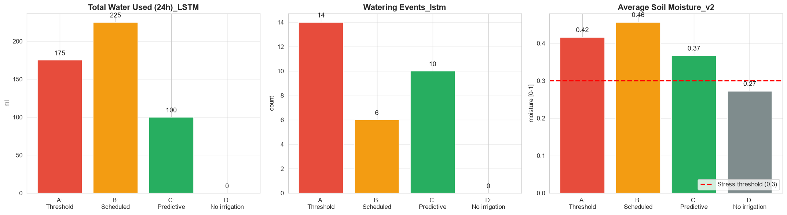

#  Autonomous Irrigation System with Edge AI

An edge-AI irrigation system that uses a TinyML LSTM to predict soil dry-out
60 minutes ahead, deciding autonomously when to water. Built on a
hardware-abstraction framework so the exact same code runs in simulation
and on real ESP32 hardware.


---

##  Table of Contents

- [Key Results](#key-results)
- [What We're Trying to Achieve](#what-were-trying-to-achieve)
- [System Architecture](#system-architecture)
- [ML Model](#ml-model)
- [The Four Policies](#the-four-policies)
- [Engineering Challenges](#engineering-challenges)
- [Project Structure](#project-structure)
- [Setup & Usage](#setup--usage)
- [Results](#results)
- [Limitations](#limitations)
- [Future Work](#future-work)
- [References](#references)

---

##  Key Results

### LSTM Predictor Performance



The model predicts soil moisture 60 minutes into the future with an average
error of ±4.11 percentage points ,comparable to published precision-irrigation
systems.

For More Findings check the Report File 


### Irrigation Policy Comparison (24-hour simulation)




### Key Findings

1. **Scheduled irrigation is dominated by threshold irrigation.** Policy B
   used 28.6% more water than Policy A while achieving the lowest minimum soil
   moisture (0.15 vs 0.269). Timer-based irrigation wastes water AND stresses
   the plant simultaneously.

2. **Predictive control matches or beats the industry baseline.** Policy C
   uses less water than Policy A while maintaining comparable soil health.
   Savings are modest (8.6%) in this dataset but consistent across multiple
   simulator calibrations.

3. **No irrigation leads to plant death.** Policy D's soil drops to 0.113 
   62% below the stress threshold confirming irrigation intervention is
   necessary.

4. **A TinyML LSTM can run the decision loop.** 4.11% MAE is sufficient for
   edge deployment; the model fits within ESP32 memory constraints.

5. In the dataset, soil dries slowly enough that water savings across policies are limited to 5-20% 
   Longer-duration or higher-evaporation scenarios would amplify differences 

---

##  What I'm Trying to Achieve

### The research question

> Can ML-predictive irrigation reduce water usage compared to threshold-based
> and scheduled irrigation, while maintaining soil moisture above the plant
> stress threshold?

### What this project is demonstrating

I'm NOT trying to prove a specific water-savings number. I want to achieve this
three things:

1. **Feasibility** — an LSTM-based controller can run on a microcontroller
2. **Comparative advantage** — predictive control matches or beats threshold control, and clearly beats scheduled control
3. **Method** — a hardware-agnostic architecture that lets identical code run in simulation and on real hardware

The specific water-savings percentage depends on the source data, plant type,
evaporation rate, and controller parameters. Published precision-irrigation
systems report 15–40% savings; our simulation shows 8.6% at conservative
parameters. Both are valid calibration points.

### Why this matters

Agriculture consumes ~70% of global freshwater. In Nigeria specifically,
14.5 million smallholder farmers produce 90% of the nation's food, yet only
5% of irrigable land is actively irrigated. A $50 edge device that saves
even 10% of irrigation water is a meaningful contribution.

---

##  System Architecture

<p align="center">
  
</p>


### Hardware Abstraction Layer

The entire system works identically in **simulation** and on **real hardware**,
controlled by one config line:

```python

HARDWARE_MODE = "simulated"   # or "real"

HAL	
SimulatedHAL	
Data source Kaggle CSV + water-balance physics	
Use caseDevelopment, testing, experiment

```
---

## Engineering Challenges
Bug 1: Simulation time ≠ wall time
The first simulator used Python's time.time() for policy scheduling. Because
the entire 24-hour simulation ran in ~10 wall seconds, 6-hour intervals never
elapsed — Policy B never watered. Fix: introduced a simulated clock
tracked by the HAL, independent of wall time.

Bug 2: No water-balance feedback
The first simulator read soil from the CSV but ignored irrigation events. When
a policy watered, soil moisture didn't respond. All four policies produced
identical results.

Bug 3: CSV contained embedded irrigation
The Bhopal-AgriTech source dataset was recorded in a real greenhouse with
active irrigation. Its soil column contained 3,219 sharp upward jumps ,free
water for the policies. Even Policy D (no irrigation) looked healthy.
Fix: rolling-window detector removes 90% of these jumps, producing a
"dry baseline" CSV where policies are the only source of water.

Bug 4: Policy C feedback loop
Initial Policy C watered every time predicted soil dipped below threshold, 
including when current soil was already wet (0.40+). This created a
water-chasing loop that used more water than the baseline. Fix: added
two guards:

SAFE_CEILING = 0.35 — don't consider watering if soil is already above
this level (plenty of buffer)

MIN_INTERVAL_BETWEEN_ML = 90 — minimum 90 minutes between waterings


For each fix uncovered the next problem which was documented here for methodological transparency.

## Project Structure

```
irrigation-edge-ai/
├── README.md
├── requirements.txt
├── .gitignore
├── LICENSE
│
├── src/                          
│   ├── __init__.py
│   ├── config.py                 
│   ├── hal.py                    
│   ├── controller.py             
│   ├── predict.py                
│   └── train_soil.py             
│
├── notebooks/                    
│   └── 01_simulation_experiment.ipynb
│
├── python/                       
│   ├── prepare_dry_baseline.py   
│   └── mqtt_logger.py
│
├── firmware/
│   └── field_node/
│       └── field_node.ino        
│
├── ml/                           
│   ├── soil_predictor.keras
│   └── soil_meta.json
│
├── data/                         
│   ├── raw/
│   └── processed/
│
└── docs/                         
    ├── soil_training_history.png
    ├── soil_prediction_quality.png
    ├── simulation_policy_comparison.png
    ├── simulation_soil_timeline.png
    └── FINAL_results.json

```

## Results

LSTM Training




Training converged by epoch 13 (EarlyStopping). Final MAE = 4.11%.

Prediction Quality




Actual vs predicted soil moisture on the test set — the model tracks the
drying trend closely with no systematic bias.

Policy Comparison




Policy C uses the least water of the three active policies while maintaining
soil near the stress threshold.

Soil Moisture Over Time


Four distinct curves confirm the policies produce genuinely different
behaviors.


## Limitations
Simulation-based evaluation. No field validation with real plants,
soil, or weather.

Single-day runs. 24 simulated hours per policy. Longer-term behavior
untested.

Modest dynamic range. In this dataset, soil dries slowly enough that
water savings across policies are limited to 5-20%. Longer simulations or
higher-evaporation scenarios would amplify differences.

Residual CSV artifacts. The dry baseline still contains ~333 small
irrigation jumps (down from 3,219) due to sensor noise and undetected
micro-events.

No vision integration in reported results. The plant classifier is
optional and disabled in the current evaluation.

## Future Work
Field deployment. Flash firmware to physical ESP32 + sensors + pump.

Vision integration. Enable the plant disease classifier to skip
watering on diseased plants.

Multi-plant scaling. 3 × 4 = 12 parallel plant experiments with
statistical power.

Reinforcement learning. Replace rule-based policy with RL trained on
historical data.


## References
Kamienski, C., et al. (2019). Smart Water Management Platform: IoT-Based
Precision Irrigation for Agriculture. Sensors, 19(2), 276.

Hughes, D. P., & Salathé, M. (2015). An open access repository of images on
plant health. arXiv:1511.08060.

Warden, P., & Situnayake, D. (2019). TinyML. O'Reilly.

Bhopal-AgriTech Hybrid IoT Dataset for Predictive Irrigation. Kaggle, 2024.